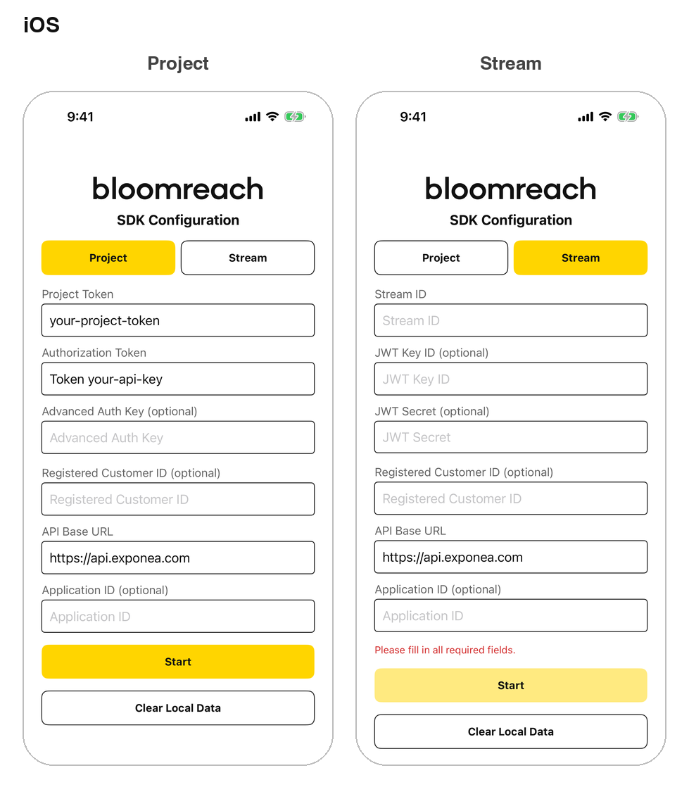
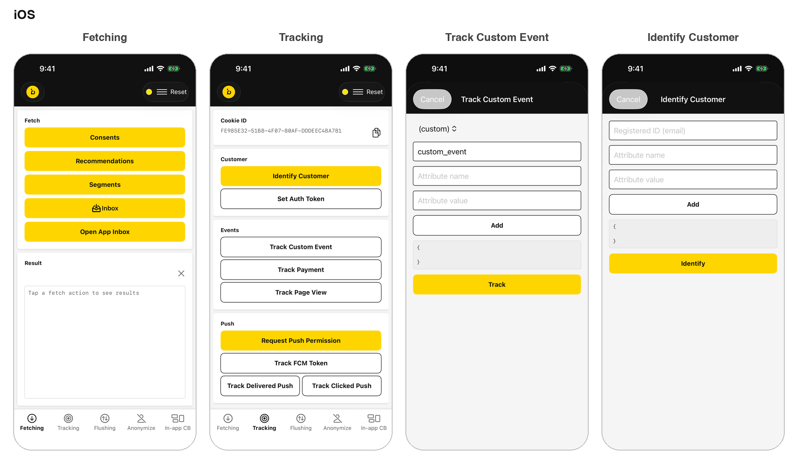
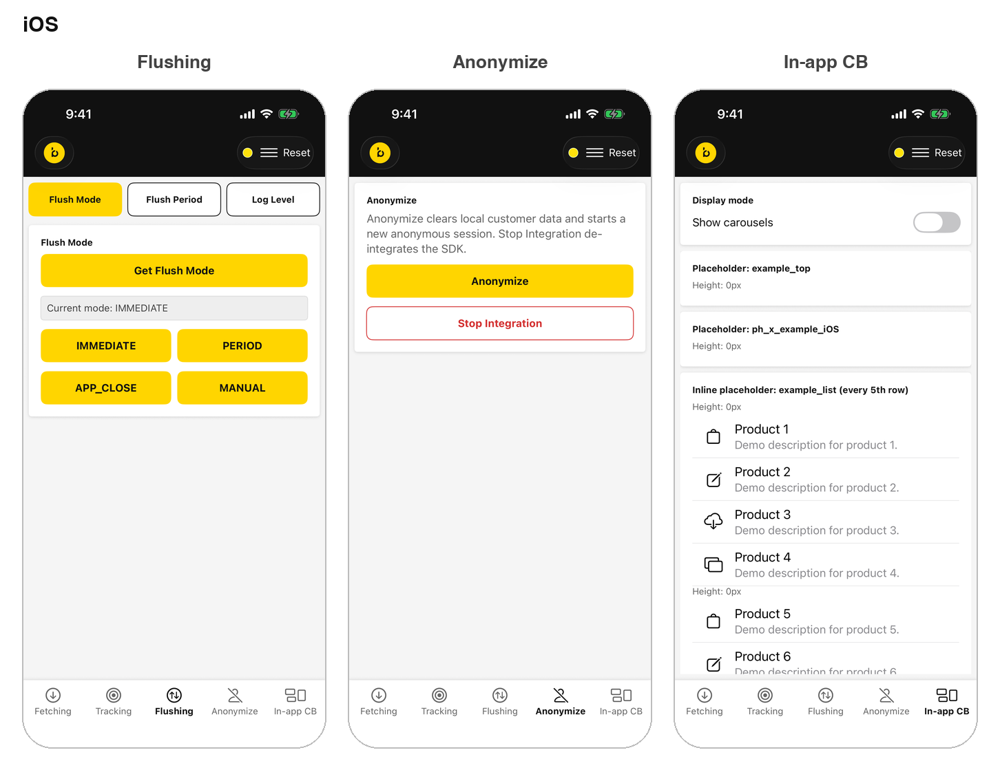

The Exponea iOS SDK includes an example application you can use as a reference implementation. You can build and run the app, test {user.mkg} features, and compare the code and behavior of your implementation with the expected behavior and code in the example app.

## Prerequisites

You must have the following software installed to be able to build and run the example app:

- Xcode
- [CocoaPods](https://cocoapods.org/)

> 📘
>
> The example app uses CocoaPods only to install the libraries that build the SDK and run its tests. This doesn't affect your app.
>
> To install the SDK in your app, use [Swift Package Manager](https://documentation.bloomreach.com/engagement/docs/ios-sdk-setup#install-with-swift-package-manager).

In Xcode, navigate to **Xcode** > **Settings** > **Locations** and make sure `Command Line Tools` is set to your Xcode version.

## Build and run the example app

1. Clone the [exponea-ios-sdk](https://github.com/exponea/exponea-ios-sdk) repository on GitHub:
   ```shell
   git clone https://github.com/exponea/exponea-ios-sdk.git
   ```
2. Run the following CocoaPods command:
   ```shell
   pod install
   ```
3. Open the `ExponeaSDK.xcworkspace` file to open the project in Xcode.
4. Navigate to **Product** > **Scheme** and select **Example**.
5. Select **Product** > **Build** (`Cmd + B`).
6. Select **Product** > **Run** (`Cmd + R`) to run the example app in the simulator.

> 📘
>
> To enable push notifications in the example app, you must also [Configure Apple Push Notification Service for iOS SDK](https://documentation.bloomreach.com/engagement/docs/ios-sdk-configure-apns) in the {user.mkg} web app. The example app includes notification service and content extensions for rich push notifications. Rich push notifications require a physical device.
>
> In debug builds on a physical device, the example app enables the SDK's push setup self-check. A few seconds after you initialize the SDK, an alert shows which push setup steps succeeded. While the self-check runs, the SDK tracks the push token even before you grant notification permission, and the `notification_state` event reports `valid=false` until you do.

## Navigate the example app



Run the app to open the **SDK Configuration** screen. The fields change depending on the selected integration type. To set it up:

1. Select your integration type using the **Project** or **Stream** toggle.
2. For **Project**:
   - Enter your **Project Token**.
   - Enter your **Authorization Token** (API key).
   - **Optional:** Enter the **Advanced Auth Key** to enable [customer token authorization](https://documentation.bloomreach.com/engagement/docs/ios-sdk-authorization#customer-token-authorization).
3. For **Stream**:
   - Enter your **Stream ID**. Find the stream ID in the {user.dh} app under **Event streams** > select your stream > **Access Security**.
   - **Optional:** Enter **JWT Key ID** and **JWT Secret** to enable local JWT token generation for testing. Both must be provided together. For more details, see [SDK auth token authorization](https://documentation.bloomreach.com/engagement/docs/ios-sdk-authorization#sdk-auth-token-authorization).
4. Enter the **API Base URL** (API base URL for the {user.br} platform).
5. **Optional:** Enter an email address hard ID in the **Registered Customer ID** field to identify the customer. Leave blank for anonymous tracking.
6. **Optional:** Enter an **Application ID** if your {user.mkg} project supports multiple mobile apps. If you leave this blank, the SDK uses the default value `default-application`. For more details, see [Configuration for iOS SDK](https://documentation.bloomreach.com/engagement/docs/ios-sdk-configuration).
7. Click **Start** to [initialize the SDK](https://documentation.bloomreach.com/engagement/docs/ios-sdk-setup#initialize-the-sdk).

The **Clear Local Data** button invokes `Exponea.shared.clearLocalCustomerData(appGroup:)` to delete all locally stored data without initializing the SDK. It also clears the values the app saved from the form.

- [`ConfigurationView.swift`](https://github.com/exponea/exponea-ios-sdk/blob/main/ExponeaSDK/Example/Configuration/ConfigurationView.swift)
- [`ExponeaService.swift`](https://github.com/exponea/exponea-ios-sdk/blob/main/ExponeaSDK/Example/Shared/SDK/ExponeaService.swift)

> 👍
>
> When using **Project** integration, prefix your API key with `Token `, for example: `Token 0b7uuqicb0fwuv1tqz7ubesxzj3kc3dje3lqyqhzd94pgwnypdiwxz45zqkhjmbf`.



After initialization, the main screen provides bottom navigation to test different SDK features. The app bar also includes:
   * SDK status indicator
   * SDK configuration overview (tap the Bloomreach logo)
   * Logs sheet
   * **Reset** action that returns to the **SDK Configuration** screen or stops the SDK integration

- The **Fetching** screen enables you to fetch consents, recommendations, and segments, and open the App Inbox.
  - [`FetchingView.swift`](https://github.com/exponea/exponea-ios-sdk/blob/main/ExponeaSDK/Example/Features/Fetching/FetchingView.swift)
  - [`AppInboxButtonRepresentable.swift`](https://github.com/exponea/exponea-ios-sdk/blob/main/ExponeaSDK/Example/Features/Fetching/AppInboxButtonRepresentable.swift)

- The **Tracking** screen shows the customer's cookie ID and enables you to identify the customer, set the SDK auth token (**Stream** integration), track custom events, payments, and page views, request push permission, and track push tokens and push delivered and clicked events. The **Track Custom Event** dialog includes presets that trigger the test in-app messages, for example `Modal`, `Fullscreen`, `Slide-in`, and `Alert Rich`.
  - [`TrackingView.swift`](https://github.com/exponea/exponea-ios-sdk/blob/main/ExponeaSDK/Example/Features/Tracking/TrackingView.swift)
  - [`IdentifyDialog.swift`](https://github.com/exponea/exponea-ios-sdk/blob/main/ExponeaSDK/Example/Shared/Components/Dialogs/IdentifyDialog.swift)
  - [`TrackCustomEventDialog.swift`](https://github.com/exponea/exponea-ios-sdk/blob/main/ExponeaSDK/Example/Shared/Components/Dialogs/TrackCustomEventDialog.swift)

- The **Flushing** screen lets you read and change the flush mode and flush period, trigger a manual data flush, and read and change the SDK log level.
  - [`FlushingView.swift`](https://github.com/exponea/exponea-ios-sdk/blob/main/ExponeaSDK/Example/Features/Flushing/FlushingView.swift)

- The **Anonymize** screen lets you anonymize the current customer and stop the SDK integration.
  - [`AnonymizeView.swift`](https://github.com/exponea/exponea-ios-sdk/blob/main/ExponeaSDK/Example/Features/Anonymize/AnonymizeView.swift)

- The **In-app CB** screen displays in-app content blocks. Use the placeholder IDs `example_top` and `example_list` in your in-app content block settings, and `ph_x_example_iOS` to test platform-specific content blocks. Turn on **Show carousels** to display the `example_carousel` and `example_carousel_ios` carousels, including a carousel that filters and sorts its content blocks.
  - [`ContentBlocksView.swift`](https://github.com/exponea/exponea-ios-sdk/blob/main/ExponeaSDK/Example/Features/ContentBlocks/ContentBlocksView.swift)
  - [`ExampleCarouselViews.swift`](https://github.com/exponea/exponea-ios-sdk/blob/main/ExponeaSDK/Example/Features/ContentBlocks/ExampleCarouselViews.swift)

The app also logs segmentation data, in-app message actions, and opened push notifications to the logs sheet, so you can see the SDK callbacks in action.
  - [`ExampleListeners.swift`](https://github.com/exponea/exponea-ios-sdk/blob/main/ExponeaSDK/Example/Shared/SDK/ExampleListeners.swift)
  - [`LogsView.swift`](https://github.com/exponea/exponea-ios-sdk/blob/main/ExponeaSDK/Example/Shared/Logging/LogsView.swift)

The app handles universal links on `mobile-sdk-example-apps.web.app` and links with the `exponea://` scheme. Links containing `fetch`, `track`, `flush`, `anonymize`, or `inappcb` open the matching screen.
  - [`Deeplinks.swift`](https://github.com/exponea/exponea-ios-sdk/blob/main/ExponeaSDK/Example/App/Deeplinks.swift)

Try out the different features in the app, then find the customer profile in the {user.mkg} web app (under `Data & Assets` > `Customers`) to see the properties and events tracked by the SDK.

If you left the **Registered Customer ID** field blank, the customer is tracked anonymously using a cookie soft ID. You can look up the cookie value on the **Tracking** screen and find the corresponding profile in the {user.mkg} web app.

If you entered a hard ID — for example, an email address — in the **Registered Customer ID** field, you can find the customer in the {user.mkg} web app by their email address.

> 📘
>
> For more information on soft IDs and hard IDs, see [Customer identification](https://documentation.bloomreach.com/engagement/docs/customer-identification).



## Troubleshooting

If you encounter any issues building the example app, the following may help:

- Remove the `Pods` folder and the `Podfile.lock` file from the project folder and rerun the `pod install` command.
- In Xcode, select `Product` > `Clean Build Folder` (Cmd + Shift + K), then `Product` > `Build` (Cmd + B).
