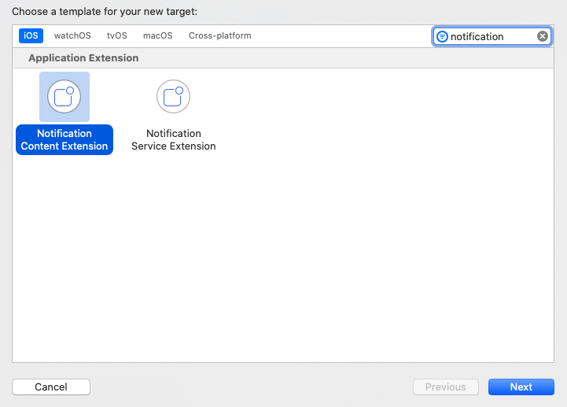
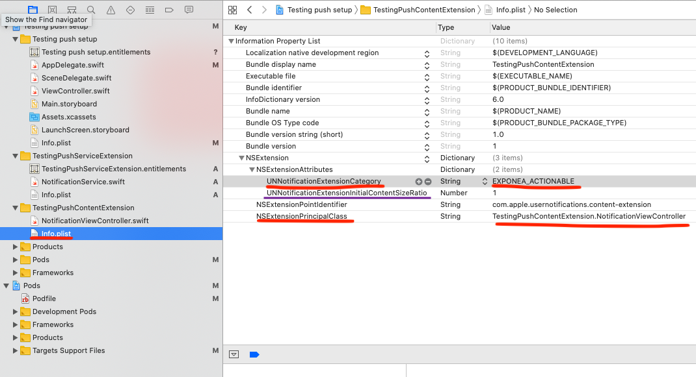

To enable certain notification features supported by the iOS SDK, you must add either one or both of the following extensions to your application:

- A [notification service extension](https://developer.apple.com/documentation/usernotifications/unnotificationserviceextension) — this type of extension lets you customize the content of a push notification before it's displayed to the user.
- A [notification content extension](https://developer.apple.com/documentation/usernotificationsui/unnotificationcontentextension) - this type of extension lets you customize the way a push notification is presented to the user.

Both extension types require the Exponea Notification Service included in the SDK.

This page describes the steps to create an extension of either type. Make sure to follow the steps for each extension.

## Step 1: Create the extension

Navigate to **File** > **New** > **Target** in Xcode and select the extension type (**Notification Service Extension** or **Notification Content Extension**).



> ❗️
>
>  Ensure the **iOS Deployment Target** of your extension matches your main app (minimum **iOS 15.0**).


## Step 2: Configure ExponeaSDK-Notifications dependency

Both extension types require a dependency on `ExponeaSDK-Notifications` so they can import `ExponeaNotificationService`.

Use the same dependency manager for the extensions as for your main app. Swift Package Manager is the recommended method.

> 🚧 No new SDK versions on CocoaPods after December 2, 2026
>
> The last SDK version we release before December 2, 2026 is the last version available on CocoaPods. Later versions, including bug fixes and security fixes, are available only through Swift Package Manager.
>
> To move your app and its extensions, follow [Migrate from CocoaPods to Swift Package Manager](https://documentation.bloomreach.com/engagement/docs/ios-sdk-setup#migrate-from-cocoapods-to-swift-package-manager).

### Swift Package Manager

`ExponeaSDK-Notifications` is a product of the same package as `ExponeaSDK`. If you haven't added the package to your project yet, follow [Install with Swift Package Manager](https://documentation.bloomreach.com/engagement/docs/ios-sdk-setup#install-with-swift-package-manager) first.

1. In your Xcode project, navigate to your app extension target's settings.
2. On the **General** tab, in the **Frameworks, Libraries, and Embedded Content** section, click on **+** and add `ExponeaSDK-Notifications`.

### CocoaPods (no new versions after December 2, 2026)

1. Add the following to the `Podfile` in the root folder of your Xcode project:
   ```
   target 'YourAppExtensionTarget' do
     pod 'ExponeaSDK-Notifications'
   end
   ```
   (Replace `YourAppExtensionTarget` with your app extension target's name)
2. In a terminal window, navigate to your Xcode project folder and run the following command:
   ```
   pod install
   ```
3. Reopen the file `HelloWorld.xcworkspace`, located in your project folder, in Xcode.

Use the same version of `ExponeaSDK-Notifications` as `ExponeaSDK` in your main app.

## Step 3: Implement the extension

#### Notification service extension

This type of extension lets you customize the content of a push notification before it's displayed to the user.

Navigate to the extension's target, and on the **Signing & Capabilities** tab, add the **App Groups** capability, selecting the same group you used for your main app.

Open `NotificationService.swift` and replace its contents with the code below to call the `ExponeaNotificationService`'s methods for processing notifications and handling timeouts.

``` swift
import UserNotifications
import ExponeaSDKNotifications

class NotificationService: UNNotificationServiceExtension {
    let exponeaService = ExponeaNotificationService(
        appGroup: "YOUR_APP_GROUP"
    )

    override func didReceive(
        _ request: UNNotificationRequest,
        withContentHandler contentHandler: @escaping (UNNotificationContent) -> Void
    ) {
        exponeaService.process(request: request, contentHandler: contentHandler)
    }

    override func serviceExtensionTimeWillExpire() {
        exponeaService.serviceExtensionTimeWillExpire()
    }
}
```

> ❗️
>
> If you manage dependencies with CocoaPods or Swift Package Manager, you must use `import ExponeaSDK_Notifications` instead of `import ExponeaSDKNotifications` in the code above.

> 📘
>
> Refer to [ExampleNotificationService](https://github.com/exponea/exponea-ios-sdk/tree/main/ExponeaSDK/ExampleNotificationService) in the [Example app for iOS SDK](https://documentation.bloomreach.com/engagement/docs/ios-sdk-example-app) for a reference implementation.

#### Notification content extension

This type of extension lets you customize the way a push notification is presented to the user.

A default storyboard file, `MainInterface.storyboard`, will be created. Delete it, you won't need it.

You'll now modify the default view controller implementation.

The service extension you created in the previous step will change the notification `categoryIdentifier` to `EXPONEA_ACTIONABLE`. You must configure the content extension to display push notifications with that category.

Open `Info.plist` in the content extension group.

- Under `NSExtension` > `NSExtensionAttributes`:
  - Set `UNNotificationExtensionCategory` to `EXPONEA_ACTIONABLE`.
- Under `NSExtension`:
  - Remove `NSExtensionMainStoryboard`.
  - Add `NSExtensionPrincipalClass` and set its value to your view controller class, for example, `TestingPushContentExtension.NotificationViewController`.



Notice the parameter `UNNotificationExtensionInitialContentSizeRatio` (with the default value 1). It specifies the ratio between the width and height of the content in the push notification. By default, the content is as high as it is wide. This setting is not part of the SDK but can cause unwanted blank space when no image is present. Change this value to 0 if you want the height to be dynamic (it will scale to the correct height if an image is present, but there will be no blank space if there is not).

Open `NotificationViewController.swift` and replace its contents with the code below so it forwards the notification to `ExponeaNotificationContentService`, which will render the rich notification.

```swift
import UIKit
import UserNotifications
import UserNotificationsUI
import ExponeaSDKNotifications

class NotificationViewController: UIViewController, UNNotificationContentExtension {
    let exponeaService = ExponeaNotificationContentService()

    func didReceive(_ notification: UNNotification) {
        exponeaService.didReceive(notification, context: extensionContext, viewController: self)
    }
}
```

> ❗️
>
> If you manage dependencies with CocoaPods or Swift Package Manager, you must use `import ExponeaSDK_Notifications` instead of ``import ExponeaSDKNotifications`` in the code above.

> 📘
>
> Refer to [ExampleNotificationContent](https://github.com/exponea/exponea-ios-sdk/tree/main/ExponeaSDK/ExampleNotificationContent) in the [Example app for iOS SDK](https://documentation.bloomreach.com/engagement/docs/ios-sdk-example-app) for a reference implementation.
