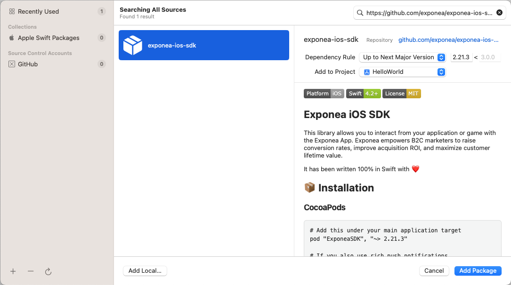
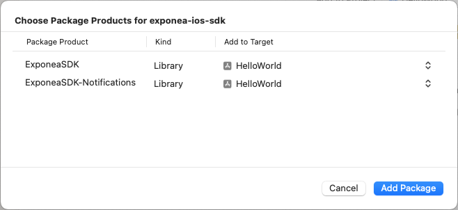
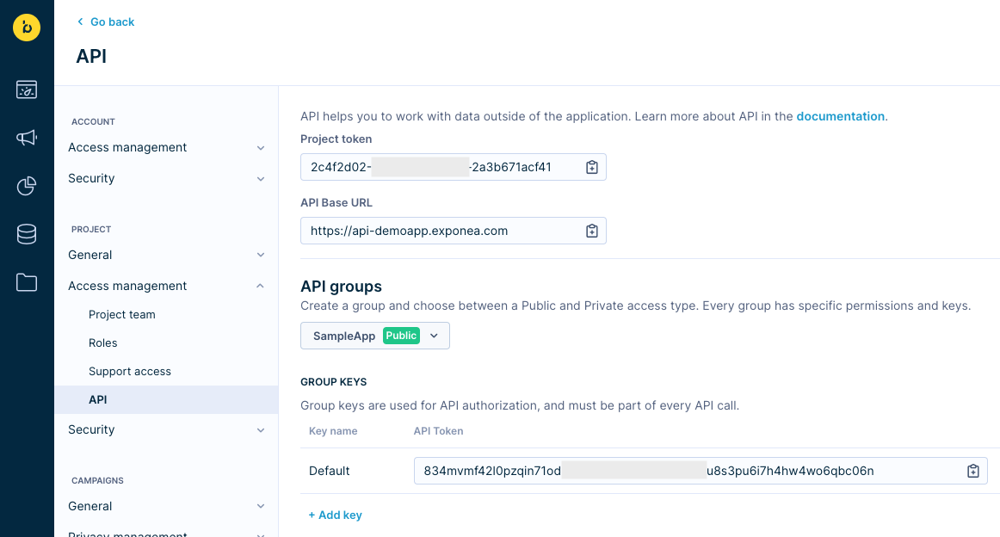

## Install the SDK

[Swift Package Manager](https://www.swift.org/package-manager/) is the recommended way to install the Exponea iOS SDK.

> 🚧 No new SDK versions on CocoaPods after December 2, 2026
>
> CocoaPods trunk becomes read-only on December 2, 2026. The last SDK version we release before that date is the last version available on CocoaPods. Later versions, including bug fixes and security fixes, are available only through Swift Package Manager.
>
> Versions already published to CocoaPods stay installable, so existing CocoaPods builds keep working.

To find the last version on CocoaPods, see the [ExponeaSDK page on CocoaPods](https://cocoapods.org/pods/ExponeaSDK). To keep receiving SDK updates, [migrate from CocoaPods to Swift Package Manager](#migrate-from-cocoapods-to-swift-package-manager).

The instructions below use the menus of recent Xcode versions. The screenshots may show an older Xcode version.

### Install with Swift Package Manager

1. Open **File** > **Add Package Dependencies...**
2. In the dialog that appears, enter the Exponea iOS SDK repository URL `https://github.com/exponea/exponea-ios-sdk` in the search box.
3. In the **Dependency Rule** section, select **Up to Next Major Version** and the SDK version.
   
4. Click on **Add Package**.
5. In the next dialog, select the `ExponeaSDK` product and set **Add to Target** to your app target. If you use rich push notifications, also select `ExponeaSDK-Notifications` and add it to your notification extension targets. You can also add it later, as described in [Notification extensions](https://documentation.bloomreach.com/engagement/docs/ios-sdk-notification-extensions).
   
6. Click on **Add Package**.

To update the SDK later, select **File** > **Packages** > **Update to Latest Package Versions**, or change the version rule in your project's **Package Dependencies** tab.

### Migrate from CocoaPods to Swift Package Manager

If your app installs the SDK with CocoaPods, follow these steps to migrate to Swift Package Manager. The steps cover the app target and the notification extension targets.

> ❗️
>
> Don't install the SDK with both CocoaPods and Swift Package Manager. Two copies cause build errors or duplicate classes at runtime. Remove the SDK pods from all targets before you add the Swift package.

1. Find your current SDK version in `Podfile.lock`, under `ExponeaSDK`. Select this version or a newer one in step 5. If you move to a newer major version, also follow the [SDK version update guide](https://documentation.bloomreach.com/engagement/docs/ios-sdk-version-update).
2. In your `Podfile`, remove the `pod "ExponeaSDK"` and `pod "ExponeaSDK-Notifications"` lines from every target, including the notification service and content extension targets. Remove any target block that is now empty.
3. Update your project:
   - **If your `Podfile` contains other pods,** run `pod install` and keep using the `.xcworkspace` file.
   - **If the SDK was your only pod,** run `pod deintegrate`, then delete the `Podfile`, `Podfile.lock`, the `Pods` folder, and the `.xcworkspace` file that CocoaPods created. Open the `.xcodeproj` file from now on.
4. If your app uses SwiftSoup through CocoaPods, move it to Swift Package Manager too. The SDK depends on SwiftSoup, and it must not be installed through both dependency managers.
5. Add the SDK package and the `ExponeaSDK` product to your app target, as described in [Install with Swift Package Manager](#install-with-swift-package-manager).
6. For each notification extension target, open the target's settings. On the **General** tab, in the **Frameworks, Libraries, and Embedded Content** section, click **+** and add `ExponeaSDK-Notifications`. Both products come from the same package, so the app and the extensions use the same SDK version.
7. Keep your code unchanged. The module names stay the same: `import ExponeaSDK` in the app and `import ExponeaSDK_Notifications` in the extensions.
8. Optional: if you set **User Script Sandboxing** to **No** only for CocoaPods, set it back to **Yes**.
9. Select **Product** > **Clean Build Folder**, then build and run the app. Check that push notifications work, including rich push notifications on a physical device.

### Install with CocoaPods (no new versions after December 2, 2026)

> 🚧
>
> Use CocoaPods only if you can't migrate to Swift Package Manager yet. CocoaPods installs stay on the last version published to CocoaPods and don't receive any later fixes.

1. Install [CocoaPods](https://cocoapods.org/) if you haven't done so yet.
2. Create a file named `Podfile` in your Xcode project folder.
3. Add the following to your `Podfile`:
   ```
   platform :ios, '15.0'
   use_frameworks!

   target 'YourAppTarget' do
     pod "ExponeaSDK"
   end

   post_install do |installer|
     installer.pods_project.targets.each do |target|
       target.build_configurations.each do |config|
         config.build_settings['IPHONEOS_DEPLOYMENT_TARGET'] = '15.0'
       end
     end
   end
   ```
   (Replace `15.0` with your desired iOS deployment target and `YourAppTarget` with your app target's name)

   The `post_install` block sets the deployment target of the SDK's dependencies, such as SwiftSoup, to iOS 15.0. Without it, Xcode 27 and later fail to build them. If your `Podfile` already has a `post_install` block, add the loop to it, because a `Podfile` can have only one.
4. In a terminal window, navigate to your Xcode project folder and run the following command:
    ```
    pod install
    ```
5. Open the file `HelloWorld.xcworkspace`, located in your project folder, in Xcode.
6. Build your app. If the build fails with a `Sandbox: ... deny` error in a `[CP]` build phase, select your project in Xcode, open the **Build Settings** tab, and under **Build Options** change **User Script Sandboxing** from **Yes** to **No**.

`pod "ExponeaSDK"` installs the newest version available on CocoaPods. For more information, refer to [Specifying pod versions](https://guides.cocoapods.org/using/the-podfile.html#specifying-pod-versions) in the CocoaPods documentation.

On CocoaPods, the SDK's SwiftSoup dependency is limited to version 2.11.3, the last version published there. Swift Package Manager installs the newest compatible SwiftSoup version.

## Initialize the SDK

Now that you have installed the SDK in your project, you must import, configure, and initialize the SDK in your application code.

> ❗️ Protect the privacy of your customers
 >
 > Make sure you have obtained and stored tracking consent from your customer before initializing Exponea iOS SDK.
 >
 > To ensure you're not tracking events without the customer's consent, you can use `Exponea.shared.clearLocalCustomerData(appGroup: String)` when a customer opts out from tracking (this applies to new users or returning customers who have previously opted out). This will bring the SDK to a state as if it was never initialized. This option also prevents reusing existing cookies for returning customers.
 >
 > Refer to [Clear local customer data](https://documentation.bloomreach.com/engagement/docs/ios-sdk-tracking#clear-local-customer-data) for details.
 >
 > If the customer denies tracking consent after Exponea iOS SDK is initialized, you can use `Exponea.shared.stopIntegration()` to stop SDK integration and remove all locally stored data.
 >
 > Refer to [Stop SDK integration](https://documentation.bloomreach.com/engagement/docs/ios-sdk-tracking#stop-sdk-integration) for details.


The SDK supports two integration modes: **Project/{user.mkg}** and **Stream/{user.dh}**. The required configuration parameters differ by mode.

**Project/{user.mkg} mode** requires `projectToken`, `authorization.token`, and `baseUrl`. You can find these as `Project token`, `API Token`, and `API Base URL` in the {user.mkg} web app under `Project settings` > `Access management` > `API`:



**Stream/{user.dh} mode** requires `streamId` (and optionally `baseUrl`). Authentication is handled via JWT tokens provided after configuration.

> 📘
>
> Refer to [Mobile SDKs API access management](https://documentation.bloomreach.com/engagement/docs/mobile-sdks-api-access-management) for details.

Import the SDK:

```swift
import ExponeaSDK
```

Initialize the SDK with **Project/{user.mkg}** settings:

```swift
Exponea.shared.configure(
    Exponea.ProjectSettings(
        projectToken: "YOUR PROJECT TOKEN",
        authorization: .token("YOUR API KEY"),
        baseUrl: "https://api.exponea.com"
    ),
    pushNotificationTracking: .disabled
)
```

Or initialize the SDK with **Stream/{user.dh}** settings:

```swift
Exponea.shared.configure(
    Exponea.StreamSettings(
        streamId: "YOUR_STREAM_ID",
        baseUrl: "https://api.exponea.com"
    ),
    pushNotificationTracking: .enabled(appGroup: "YOUR_APP_GROUP")
)

> 📘 Note
>
> Refer to {user.dh} documentation for more details on how you can [configure iOS SDK with JWT authentication](https://documentation.bloomreach.com/data-hub/docs/configure-android-sdk-with-jwt-authentication)

// After configuration, register JWT error handler and provide initial token:
Exponea.shared.setJwtErrorHandler { context in
    yourBackend.fetchNewJwt { newToken in
        Exponea.shared.setSdkAuthToken(newToken)
    }
}
Exponea.shared.setSdkAuthToken("YOUR_STREAM_JWT_TOKEN")
```

> For Stream mode, see [Stream JWT authorization](https://documentation.bloomreach.com/engagement/docs/ios-sdk-authorization#stream-jwt-authorization-data-hub) for details on JWT lifecycle management.

Your `AppDelegate`'s `application:didFinishLaunchingWithOptions` method is typically a good place to do the initialization but, depending on your application design, it can be anywhere in your code.

> 📘
>
> If your app uses the UIScene lifecycle (`UIApplicationSceneManifest`), also subclass [`ExponeaSceneDelegate`](https://github.com/exponea/exponea-ios-sdk/blob/main/ExponeaSDK/ExponeaSDK/Classes/ExponeaSceneDelegate.swift) in your `SceneDelegate` to track universal links. Push notifications still rely on `ExponeaAppDelegate` / `UIApplicationDelegate` and need no scene delegate changes. Learn more about [universal links for the iOS SDK](https://documentation.bloomreach.com/engagement/docs/ios-sdk-universal-links).

At this point, the SDK is active and should now be tracking customers and events in your app.

####Configure application ID
*Multiple mobile apps:* If your {user.mkg} project supports multiple mobile apps, specify the `applicationID` in your configuration. This helps distinguish between different apps in your project.

```swift
Exponea.shared.configure(
    Exponea.ProjectSettings(
        projectToken: "YOUR PROJECT TOKEN",
        authorization: .token("YOUR API KEY"),
        baseUrl: "https://api.exponea.com",
        applicationID: "<Your application id>" 
    ),
    pushNotificationTracking: .disabled
)
```

Make sure your `applicationID` value matches exactly Application ID configured in your {user.mkg} under **Project Settings > Campaigns > Channels > Push Notifications.**

*Single mobile app:* If your {user.mkg} project supports only one app, you can skip the `applicationID` configuration. The SDK will automatically use the default value `default-application`.

SDK initialization immediately creates a new customer profile with a new cookie [soft ID](https://documentation.bloomreach.com/engagement/docs/customer-identification#soft-id) unless the customer has been [identified](https://documentation.bloomreach.com/engagement/docs/ios-sdk-tracking#identify) previously.

> 📘
>
> Refer to [Tracking for iOS SDK](https://documentation.bloomreach.com/engagement/docs/ios-sdk-tracking) for details on which events are automatically tracked by the SDK.

> ❗️ 
> 
> [Configuring the SDK using a `plist` file](https://documentation.bloomreach.com/engagement/docs/ios-sdk-configuration#using-a-configuration-file---legacy) is deprecated but still supported for backward compatibility.

## Other SDK configuration

### Advanced configuration

The SDK can be further configured by providing additional parameters to the `configure` method. For a complete list of available configuration parameters, refer to the [Configuration for iOS SDK](https://documentation.bloomreach.com/engagement/docs/ios-sdk-configuration) documentation.

### Log level

The SDK supports the following log levels:

| Log level  | Description |
| -----------| ----------- |
| `.none`    | Disables all logging |
| `.error`   | Serious errors or breaking issues |
| `.warning` | Warnings and recommendations + `.error` |
| `.verbose` | Information about all SDK actions + `.warning` + `.error`. |

The default log level is `.warn`. While developing or debugging, setting the log level to `.verbose` can be helpful.

You can set the log level at runtime as follows:

```swift
Exponea.logger.logLevel = .verbose
```
  
> 👍 
> 
> For better visibility, log messages from the SDK are prefixed with `[EXP-iOS]`.

### Authorization

Read [Authorization for iOS SDK](https://documentation.bloomreach.com/engagement/docs/ios-sdk-authorization) to learn more about the different authorization modes supported by the SDK and how to use [customer token](https://documentation.bloomreach.com/engagement/docs/customer-token) authorization.

### Data flushing

Read [Data flushing for iOS SDK](https://documentation.bloomreach.com/engagement/docs/ios-sdk-data-flushing) to learn more about how the SDK uploads data to the {user.mkg} API and how to customize this behavior.
